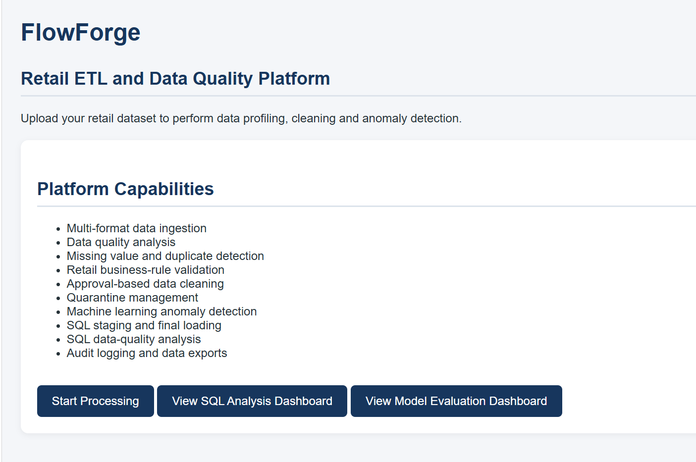
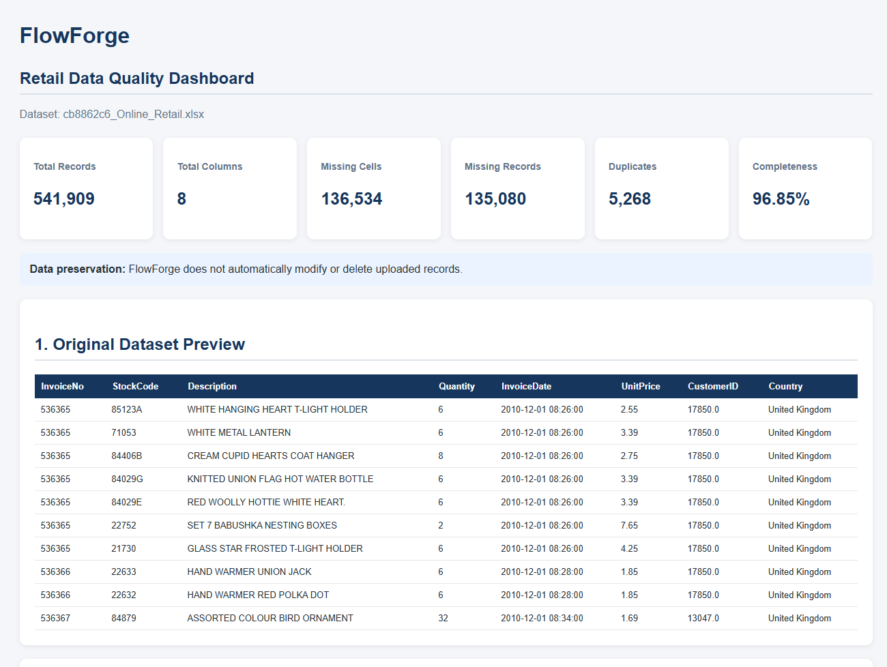
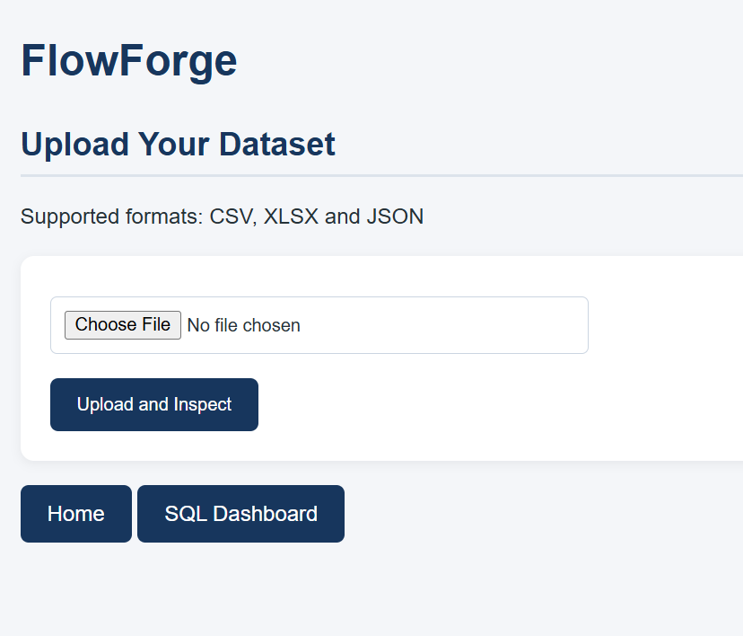
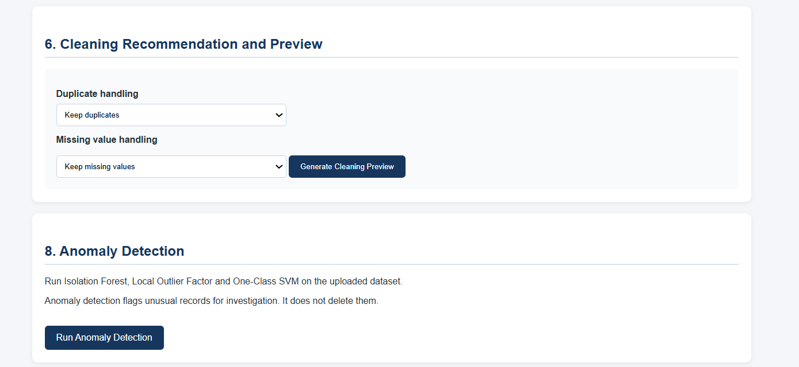
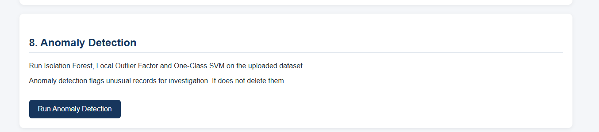
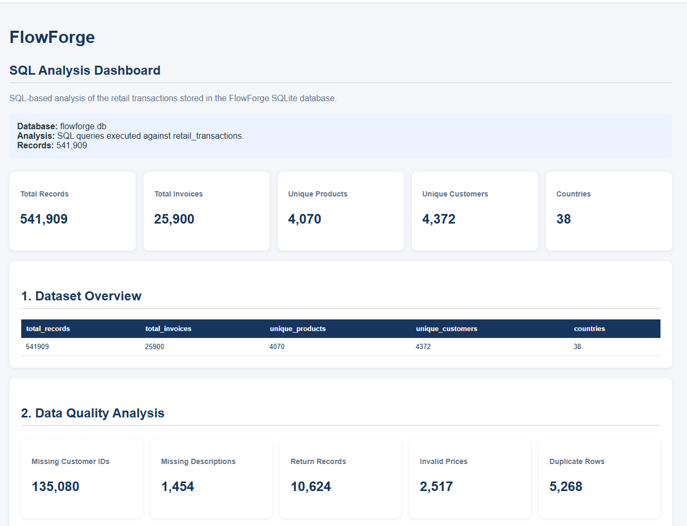
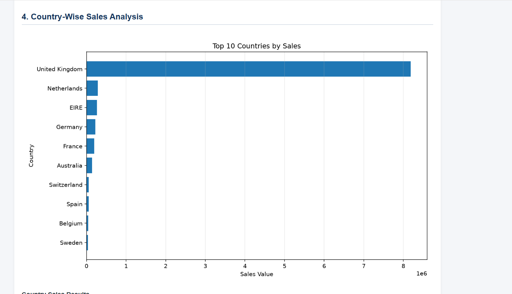
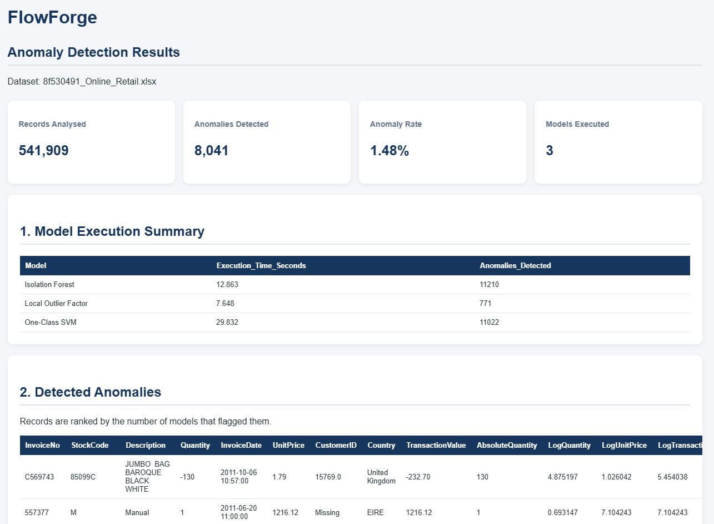

# FlowForge
## Retail ETL and Data Quality Platform

FlowForge is a Python-based retail ETL and data-quality platform designed to process retail transaction data, identify data-quality issues, perform controlled data cleaning, and detect anomalous transactions using machine learning algorithms.

The project uses the Online Retail dataset containing 541,909 transaction records and 8 columns.

## 1. Project Objectives

- Ingest retail datasets in multiple formats.
- Perform data profiling and quality analysis.
- Identify missing values and duplicate records.
- Validate retail business rules.
- Preview and approve data-cleaning operations.
- Separate quarantined records from cleaned data.
- Detect anomalies using machine learning.
- Compare anomaly detection model performance.
- Maintain an audit log of cleaning activities.

## 2. Technology Stack

| Component | Technology |
|---|---|
| Programming Language | Python |
| Data Processing | Pandas, NumPy |
| Machine Learning | Scikit-learn |
| Data Visualization | Matplotlib |
| Web Application | Flask |
| Frontend | HTML, CSS |
| Development Environment | VS Code |
| Dataset | Online Retail Dataset |

## 3. Project Structure

```text
Flowforge Project/
│
├── app.py
├── etl_engine.py
├── anomaly_detection.py
├── feature_engineering.py
├── model_evaluation.py
├── model_evaluation_dashboard.py
├── compare_all_models.py
├── requirements.txt
│
├── test_anomaly.py
├── test_anomaly_pipeline.py
├── test_cleaning.py
├── test_etl.py
├── test_feature_engineering.py
├── test_lof_clean.py
├── test_lof_success.py
├── test_model_comparison.py
├── test_model_comparison_v2.py
├── test_model_comparison_v3.py
├── test_quality.py
├── diagnose_lof.py
│
├── uploads/
│
└── exports/
    ├── audit_log.csv
    ├── model_evaluation_metrics.csv
    ├── model_evaluation_predictions.csv
    └── visualizations/
        └── flowforge_model_evaluation_dashboard.png

## 4. Application Screenshots

### 4.1 FlowForge Home Page


### 4.2 Data Profiling Dashboard


### 4.3 Data Cleaning and Validation


### 4.4 Anomaly Detection


### 4.5 SQL Analytics Dashboard


### 4.6 Model Evaluation Dashboard

```

## 5. ETL and Data Quality Workflow

### Data Ingestion
Users can upload CSV, XLSX and XLS datasets through the Flask application.

### Data Profiling
The platform analyses:
- Total records and columns
- Missing values
- Duplicate records
- Numeric data distributions
- Retail business-rule exceptions

### Data Cleaning
Users can preview and approve selected cleaning operations:
- Duplicate removal
- Missing-value handling
- Invalid-value handling
- Outlier handling

### Quarantine Management
Records removed during approved cleaning operations are exported separately for further investigation.

### Audit Logging
Cleaning activities are recorded with timestamps, source filenames, selected actions, and record counts.

## 6. Feature Engineering

The feature engineering module generates retail transaction features, including:

- TransactionValue
- AbsoluteQuantity
- LogQuantity
- LogUnitPrice
- LogTransactionValue
- IsReturn
- IsZeroPrice

These features are used by the anomaly detection models.

## 7. Machine Learning Models

FlowForge implements three anomaly detection algorithms:

1. Isolation Forest
2. Local Outlier Factor (LOF)
3. One-Class Support Vector Machine (One-Class SVM)

A majority-voting ensemble combines the individual model predictions. A record is flagged by the ensemble when at least two models identify it as anomalous.

## 8. Model Evaluation

The evaluation module uses an 80:20 training and testing split.

Synthetic anomalies are injected into the test dataset to evaluate model performance against known injected labels.

Evaluation metrics include:

- Precision
- Recall
- F1 Score
- True Positives
- True Negatives
- False Positives
- False Negatives
- Execution Time

The model evaluation dashboard provides a visual comparison of the individual algorithms and ensemble.

**Important:** The evaluation metrics represent performance against synthetically injected anomalies. They should not be interpreted as verified real-world fraud detection accuracy.

## 9. Installation and Execution

### Step 1: Clone the repository

```bash
git clone <your-github-repository-url>
cd Flowforge-Project
```

### Step 2: Create a virtual environment

```bash
python -m venv .venv
```

### Step 3: Activate the environment

Windows PowerShell:

```powershell
.venv\Scripts\Activate.ps1
```

### Step 4: Install dependencies

```bash
pip install -r requirements.txt
```

### Step 5: Start the application

```bash
python app.py
```

Open the application:

```text
http://127.0.0.1:5000
```

### Step 6: Run model evaluation

```bash
python model_evaluation.py
```

### Step 7: Generate the evaluation dashboard

```bash
python model_evaluation_dashboard.py
```

## 10. Generated Outputs

The application generates:
- Cleaned datasets
- Quarantined datasets
- Complete anomaly analysis results
- Detected anomaly records
- Model execution summaries
- Model evaluation metrics
- Model evaluation predictions
- Audit logs
- Model evaluation dashboard image

## 11. Future Enhancements

- SQL-based staging and final data loading.
- Expanded automated testing.
- Additional data-quality monitoring.
- Improved reporting and visualization.

## 12. Project Status

The Flask application, data upload, data-quality analysis, cleaning approval, quarantine exports, anomaly detection, model evaluation dashboard, and audit logging have been tested successfully in the local development environment.

---

**FlowForge — Retail ETL and Data Quality Platform**

Developed as a Data Science and Machine Learning project.
